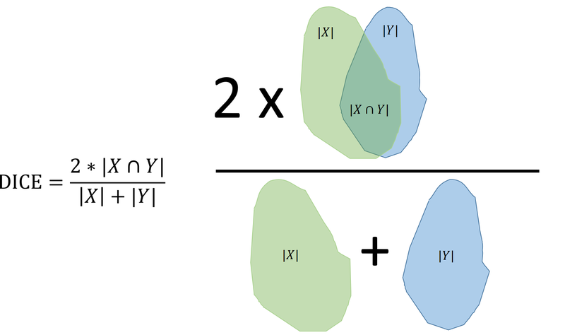

***Solution is now available! Download the full solution from here:*** [Solution](../downloads/sol_material-6.zip){ .md-button .md-button--primary .inline-button }

## Explorative analysis of one CT scan

Let us start by examining one of the CT scan slices from the training set. You can read the first slice like this:

```python
in_dir = "data/"
ct = dicom.dcmread(in_dir + 'Training.dcm')
img = ct.pixel_array
print(img.shape)
print(img.dtype)
```

You should visualise the slice, so the organs of interest have a suitable brigthness and contrast. One way is to manipulate the minimum and maximum values proviede to `imshow`.

**Exercise 1**: *The spleen typically has HU units in the range of 0 to 150. Try to make a good visualization of the CT scan and spleen using (replace the question marks with values):*

```python
io.imshow(img, vmin=?, vmax=?, cmap='gray')
io.show()
```

<!-- START_SOLUTION 1 -->
??? tip "Solution 1"
    ```py

    io.imshow(img, vmin=0, vmax=100, cmap='gray')
    io.show()
    ```
    ```py
    spleen_roi = io.imread(in_dir + 'SpleenROI.png')
    # convert to boolean image
    spleen_mask = spleen_roi > 0
    spleen_values = img[spleen_mask]
    ```
<!-- END_SOLUTION 1 -->

An expert has provided annotations of **bone, fat, kidneys, liver and spleen**. They are stored as *mask* files which is an image with the same size as the input image, where the annotated pixels are 1 and the rest are 0. They are found as **BoneROI.png, FatROI.png, KidneyROI.png, LiverROI and SpleenROI.png**.

You can use the original image and a mask to get the values of the pixels inside the mask:

```python
spleen_roi = io.imread(in_dir + 'SpleenROI.png')
# convert to boolean image
spleen_mask = spleen_roi > 0
spleen_values = img[spleen_mask]
```

**Exercise 2**: *Compute the average and standard deviation of the Hounsfield units found in the spleen in the training image. Do they correspond to the values found in the above figure?*

<!-- START_SOLUTION 2 -->
??? tip "Solution 2"
    ```py


    mu_spleen = np.mean(spleen_values)
    std_spleen = np.std(spleen_values)

    print(f'Mean {mu_spleen} - Std {std_spleen}')
    ```
<!-- END_SOLUTION 2 -->

**Exercise 3**: *Plot a histogram of the pixel values of the spleen. Does it look like they are Gaussian distributed?*

<!-- START_SOLUTION 3 -->
??? tip "Solution 3"
    ```py

    n, bins, patches = plt.hist(spleen_values, 60, density=1)
    plt.xlabel('Hounsfield unit')
    plt.ylabel('Frequency')
    plt.title('Spleen values in CT scan')
    plt.show()
    ```
    Yes, it looks like the pixel values of the spleen are Gaussian distributed.
<!-- END_SOLUTION 3 -->

The function [`norm.pdf`](https://docs.scipy.org/doc/scipy/reference/generated/scipy.stats.norm.html) from `SciPy`  represents a Gaussian probability density function (PDF). It can for example be used to plot a Gaussian
distribution with a given mean and standard deviation.

This can be used to create a fitted Gaussian distribution of the spleen values:

```python
n, bins, patches = plt.hist(spleen_values, 60, density=1)
pdf_spleen = norm.pdf(bins, mu_spleen, std_spleen)
plt.plot(bins, pdf_spleen)
plt.xlabel('Hounsfield unit')
plt.ylabel('Frequency')
plt.title('Spleen values in CT scan')
plt.show()
```

Here `mu_spleen` and `std_spleen` are the average and standard deviation of the spleen values.

**Exercise 4**: *Plot histograms and their fitted Gaussians of several of the tissues types. Do they all look like they are Gaussian distributed?*

<!-- START_SOLUTION 4 -->
??? tip "Solution 4"
    Plotting the same histogram as above, but now with a Gaussian probability function (PDF) on top:

    ```py
    n, bins, patches = plt.hist(spleen_values, 60, density=1)
    pdf_spleen = norm.pdf(bins, mu_spleen, std_spleen)
    plt.plot(bins, pdf_spleen)
    plt.xlabel('Hounsfield unit')
    plt.ylabel('Frequency')
    plt.title('Spleen values in CT scan')
    plt.show()
    ```
    Plotting histograms and PDFs for all the tissues types:

    ```py
    def load_mask(mask_path):
        roi = io.imread(mask_path)
        mask = roi > 0
        return mask

    def get_values(img, mask_path):
        mask = load_mask(mask_path)
        return img[mask]


    paths = ['BoneROI.png', 'FatROI.png', 'KidneyROI.png', 'LiverROI.png', 'SpleenROI.png']
    values = [get_values(img, in_dir + path) for path in paths]
    ```

    ```py
    def get_gaussian_distributions(values, min_hu = -200, max_hu = 1000):
        hu_range = np.arange(min_hu, max_hu, 1.0)
        mu = np.mean(values)
        std = np.std(values)
        pdf = norm.pdf(hu_range, mu, std)
        return pdf
    ```

    ```py
    for value, name in zip(values, paths):
        n, bins, patches = plt.hist(value, 60, density=1)
        mu = np.mean(value)
        std = np.std(value)
        pdf = norm.pdf(bins, mu, std)
        plt.plot(bins, pdf)
        plt.xlabel('Hounsfield unit')
        plt.ylabel('Frequency')
        plt.title(name)
        plt.show()
    ```
    Most of the distributions resemble a Gaussian shape quite well, except for the one corresponding to the bone pixels.
<!-- END_SOLUTION 4 -->

The fitted Gaussians are good for inspecting class separation and how much the class overlap. Plotting several fitted Gaussians can for example be done like this:

```python
# Hounsfield unit limits of the plot
min_hu = -200
max_hu = 1000
hu_range = np.arange(min_hu, max_hu, 1.0)
pdf_spleen = norm.pdf(hu_range, mu_spleen, std_spleen)
pdf_bone = norm.pdf(hu_range, mu_bone, std_bone)
plt.plot(hu_range, pdf_spleen, 'r--', label="spleen")
plt.plot(hu_range, pdf_bone, 'g', label="bone")
plt.title("Fitted Gaussians")
plt.legend()
plt.show()
```

**Exercise 5**: *Plot the fitted Gaussians of bone, fat, kidneys, liver and spleen. What classes are easy to seperate and which classes are hard to seperate?*

<!-- START_SOLUTION 5 -->
??? tip "Solution 5"
    ```py

    # Hounsfield unit limits of the plot
    min_hu, max_hu = -200, 1000
    hu_range = np.arange(min_hu, max_hu, 1.0)
    pdfs = [get_gaussian_distributions(value) for value in values]

    for pdf, path in zip(pdfs, paths):
        plt.plot(hu_range, pdf, label=path)
    
    plt.title("Fitted Gaussians")
    plt.legend()
    plt.show()
    ```
<!-- END_SOLUTION 5 -->

**Exercise 6**: *Define the classes that we aim at classifying. Perhaps some classes should be combined into one class?*

<!-- START_SOLUTION 6 -->
??? tip "Solution 6"
    We can differenciate intensity-wise the fat, soft tissues (kidney, liver, spleen) and bone.
<!-- END_SOLUTION 6 -->

## Minimum distance pixel classification

In the **minimum distance classifier** the pixel value class ranges are defined using the average values of the training values. If you have two classes, the threshold between them is defined as the mid-point between the two class value averages.

In the following, we will define four classes: **background, fat, soft tissue and bone**, where soft-tissue is a combination of the values of the spleen, liver and kidneys. 
We manually set the threshold for background to -200. So all pixels below -200 are set to background.

**Exercise 7**: *Compute the class ranges defining fat, soft tissue and bone.*

<!-- START_SOLUTION 7 -->
??? tip "Solution 7"
    ```py

    vals_soft_tissue = np.concatenate(values[-3:])
    soft_tissue_mean = np.mean(vals_soft_tissue)
    bone_mean = np.mean(values[0])
    fat_mean = np.mean(values[1])

    print(f'Soft tissue mean: {soft_tissue_mean} - Bone mean: {bone_mean} - Fat mean: {fat_mean}')
    ```
    ```py
    t_fat_soft = (soft_tissue_mean + fat_mean)/2
    t_bone_soft = (soft_tissue_mean + bone_mean)/2
    ```
<!-- END_SOLUTION 7 -->

You can now use:

```python
t_background = -200
fat_img = (img > t_background) & (img <= t_fat_soft)
```

to create an image where all the pixel that are classified as fat, will be 1 and the rest 0. Here `t_fat_soft` is the threshold between the fat and the soft tissue class.

**Exercise 8**: *Create class images: fat_img, soft_img and bone_img representing the fat, soft tissue and bone found in the image.*

<!-- START_SOLUTION 8 -->
??? tip "Solution 8"
    ```py


    t_background = -200
    fat_img = (img > t_background) & (img <= t_fat_soft)
    soft_img = (img > t_fat_soft) & (img <= t_bone_soft)
    bone_img = (img > t_bone_soft)
    ```
<!-- END_SOLUTION 8 -->

To visualize the classification results you can use:

```python
label_img = fat_img + 2 * soft_img + 3 * bone_img
image_label_overlay = label2rgb(label_img)
show_comparison(img, image_label_overlay, 'Classification result')
```

**Exercise 9**: *Visualize your classification result and compare it to the anatomical image in the start of the exercise. Does your results look plausible?*

<!-- START_SOLUTION 9 -->
??? tip "Solution 9"
    ```py

    label_img = fat_img + 2 * soft_img + 3 * bone_img
    image_label_overlay = label2rgb(label_img)
    show_comparison(img, image_label_overlay, 'Classification result')
    ```
    Results are not plausible. Bone (yellow), soft tissue (blue) and fat (red) are not well segmented and separated. For instance all of the vertebra should be yellow and right now most of it is blue.
<!-- END_SOLUTION 9 -->

## Parametric pixel classification

In the **parametric classifier**, the standard deviation of the training pixel values is also used when determinin the class ranges. In the following, we are also trying to classify **background, fat, soft tissue and bone**.

We start by finding the class ranges by manually inspecting the fitted Gaussians from each class.

As in the last exercise, we can still se the background-fat threshold to be -200.

**Exercise 10**: *Plot the fitted Gaussians of the training values and manually find the intersection between the curves.*

<!-- START_SOLUTION 10 -->
??? tip "Solution 10"
    ```py

    # Hounsfield unit limits of the plot
    min_hu, max_hu = -200, 1000
    hu_range = np.arange(min_hu, max_hu, 1.0)
    values_3_classes = [values[0], values[1], vals_soft_tissue]
    labels_3_classes = ['Bone', 'Fat', 'Soft tissue']

    pdfs_3_classes = [get_gaussian_distributions(value) for value in values_3_classes]

    for pdf, path in zip(pdfs_3_classes, labels_3_classes):
        plt.plot(hu_range, pdf, label=path)
    
    plt.title("Fitted Gaussians - Tissue wise")
    plt.legend()
    plt.show()
    ```
    Zooming in on the plot in order to do manual inspection:

    ```py
    # Manual intersection Fat - Soft
    for pdf, path in zip(pdfs_3_classes, labels_3_classes):
        plt.plot(hu_range, pdf, label=path)
    plt.title("Intersection Fat - Soft")
    plt.xlim(-45, -44)
    plt.ylim(0, 1e-7)
    plt.legend()
    plt.show()

    # Manual intersection  Soft - Bone
    for pdf, path in zip(pdfs_3_classes, labels_3_classes):
        plt.plot(hu_range, pdf, label=path)
    
    plt.title("Intersection Soft - Bone")
    plt.xlim(138, 142)
    plt.ylim(0, 1e-8)
    plt.legend()
    plt.show()
    ```

    ```py
    # Values found by inspecting the plot and seeing where the Gaussian crosses
    thres_fat_soft = -45 
    thres_soft_bone = 140
    ```
    The below code can also help you find the place where the Gaussians intersect:
    ```py
    # This cell helps you to define an 
    # interval for the intersection of the gaussians. 
    # Just change the test_value and run the cell again

    mu_bone = np.mean(values_3_classes[0])
    std_bone = np.std(values_3_classes[0])

    mu_fat = np.mean(values_3_classes[1])
    std_fat = np.std(values_3_classes[1])

    mu_soft = np.mean(values_3_classes[2])
    std_soft = np.std(values_3_classes[2])

    # Soft vs Bone
    test_value = 140
    if norm.pdf(test_value, mu_soft, std_soft) > norm.pdf(test_value, mu_bone, std_bone):
    	print(f"For value {test_value} the class is soft tissue")
    else:
    	print(f"For value {test_value} the class is bone")
 
    # Soft vs Fat
    test_value = -45
    if norm.pdf(test_value, mu_soft, std_soft) > norm.pdf(test_value, mu_fat, std_fat):
    	print(f"For value {test_value} the class is soft tissue")
    else:
    	print(f"For value {test_value} the class is fat")
    ```
<!-- END_SOLUTION 10 -->

**Exercise 11**: *Use the same technique as in exercise 7, 8 and 9 to visualize your classification results. Did it change compared to the minimum distance classifier?*

<!-- START_SOLUTION 11 -->
??? tip "Solution 11"
    ```py

    # Defining binary images and plotting
    t_background = -200 # Given from assignment text
    fat_img = (img > t_background) & (img <= thres_fat_soft)
    soft_img = (img > thres_fat_soft) & (img <= thres_soft_bone)
    bone_img = (img > thres_soft_bone)

    label_img = fat_img + 2 * soft_img + 3 * bone_img
    image_label_overlay = label2rgb(label_img)
    show_comparison(img, image_label_overlay, 'Classification result')
    ```
    The results look more plausible now, although not perfect.
<!-- END_SOLUTION 11 -->

An alternative way of finding the class ranges is to test which class has a the highest probability for a given value. The `norm.pdf` function can be used for that. For example:

```python
if norm.pdf(test_value, mu_soft, std_soft) > norm.pdf(test_value, mu_bone, std_bone):
	print(f"For value {test_value} the class is soft tissue")
else:
	print(f"For value {test_value} the class is bone")
```

here the `test_value` is a pixel value that you want to assign a class. One way to use this is to create a *look-up-table* where for each possible HU unit (for example 100, 101, 102 etc), the most probably class is noted. Doing this will give you the pixel value, where the two neighbouring classes meet.

**Exercise 12**: *Use `norm.pdf` to find the optimal class ranges between fat, soft tissue and bone.*

<!-- START_SOLUTION 12 -->
??? tip "Solution 12"
    ```py

    # Automatic intersection Fat - Soft
    for test_value in np.linspace(mu_fat, mu_soft, 1000):
        if norm.pdf(test_value, mu_soft, std_soft) > norm.pdf(test_value, mu_fat, std_fat):
            thres_fat_soft = test_value
            print(f"Fat - Soft threshold: {thres_fat_soft}")
            break

    # Automatic intersection Soft - Bone
    for test_value in np.linspace(mu_soft, mu_bone, 1000):
        if norm.pdf(test_value, mu_bone, std_bone) > norm.pdf(test_value, mu_soft, std_soft):
            thres_soft_bone = test_value
            print(f"Soft - Bone threshold: {thres_soft_bone}")
            break
    ```
<!-- END_SOLUTION 12 -->

## Object segmentation - The spleen finder

The goal of this part of the exercise, is to create a program that can automatically segment the spleen in CT images.

We start by using the **Training.dcm** image and the expert provided annotations.

**Exercise 13**: *Inspect the values of the spleen as in exercise 3 and select a lower and upper threshold to create a spleen class range.*

<!-- START_SOLUTION 13 -->
??? tip "Solution 13"
    ```py

    in_dir = "data/"
    ct = dicom.dcmread(in_dir + 'Training.dcm')
    img = ct.pixel_array

    path = "SpleenROI.png"
    spleen_mask = load_mask(in_dir + path)
    spleen_values = img[spleen_mask]

    # fig, ax = plt.subplots()
    # ax.imshow(spleen_mask)

    fig, ax = plt.subplots()
    n, bins, patches = ax.hist(spleen_values, 60, density=1)
    pdf_spleen = norm.pdf(bins, mu_spleen, std_spleen)
    ax.plot(bins, pdf_spleen)
    ax.set_xlabel('Hounsfield unit')
    ax.set_ylabel('Frequency')
    ax.set_title('Spleen values in CT scan')
    plt.show()

    t_1, t_2 = 20, 80
    ```
<!-- END_SOLUTION 13 -->

You can now use:

```python
spleen_estimate = (img > t_1) & (img < t_2)
spleen_label_colour = color.label2rgb(spleen_estimate)
io.imshow(spleen_label_colour)
plt.title("First spleen estimate")
io.show()
```

to show your first spleen estimate. As can be seen, there a many non-spleen areas in the result. The spleen is also connected to another anatomy. 


Luckily, we can use [morphological operations](https://dtuimageanalysisorg.github.io/DTUImageAnalysis/ex4b/ex4b-morph/) to fix these issues.

**Exercise 14**: *Use morphological operations to seperate the spleen from other organs and close holes. Change the values where there are question marks to change the size of the used structuring elements.*

??? EXAMPLE "Code Template - Exercise 14"
    A good starting point could be:
    ```python
    footprint = disk(?)
    closed = binary_closing(spleen_estimate, footprint)

    footprint = disk(?)
    opened = binary_opening(closed, footprint)
    ```

<!-- START_SOLUTION 14 -->
??? tip "Solution 14"
    ```py

    spleen_estimate = (img > t_1) & (img < t_2)
    spleen_label_colour = color.label2rgb(spleen_estimate)
    io.imshow(spleen_label_colour)
    plt.title("First spleen estimate")
    io.show()
    ```
    ```py
    footprint = disk(2)
    closed = binary_closing(spleen_estimate, footprint)
    spleen_label_colour = color.label2rgb(closed)

    io.imshow(spleen_label_colour)
    plt.title("Closed spleen estimate")
    io.show()

    footprint = disk(4)
    opened = binary_opening(closed, footprint)
    spleen_label_colour = color.label2rgb(opened)
    io.imshow(spleen_label_colour)
    plt.title("Opened spleen estimate")
    io.show()
    ```
<!-- END_SOLUTION 14 -->

Now we can use [BLOB](https://dtuimageanalysisorg.github.io/DTUImageAnalysis/ex5/ex5-blob/) analysis to do a feature based classification of the spleen.

**Exercise 15**: *Use the methods from [BLOB](https://dtuimageanalysisorg.github.io/DTUImageAnalysis/ex5/ex5-blob/) analysis to compute BLOB features for every seperated BLOB in the image.*
 
??? EXAMPLE "Code Template - Exercise 15"
    You can for example start by:
    ```python
    label_img = measure.label(opened)
    ```

<!-- START_SOLUTION 15 -->
??? tip "Solution 15"
    ```py

    label_img = measure.label(opened)
    im_blob = label2rgb(label_img)

    plt.imshow(im_blob)
    plt.show()
    ```
<!-- END_SOLUTION 15 -->

**Exercise 16**: *Inspect the labeled image and validate the success of separating the spleen from the other objects. If it is connected (have the same color) to another organ, you should experiment with the kernel sizes in the morphological operations.*

<!-- START_SOLUTION 16 -->
??? tip "Solution 16"
    We have isolated the spleen as a separate object through the above morphological operations. It is not connected to any other BLOBs. However, we still need to remove all BLOBs that are not the spleen.
<!-- END_SOLUTION 16 -->

To be able to keep only the spleen we need to find out which BLOB features, that is special for the spleen. By using `measure.regionprops` many different BLOB features can be computed, including area and perimeter. You can find the catalog of available features from [here](https://scikit-image.org/docs/stable/api/skimage.measure.html#skimage.measure.regionprops). 

**Exercise 17**: *Using a combination of features and feature value limits, filter the image such that only the spleen remains in the output image.*

??? EXAMPLE "Code Template - Exercise 17"
    To start, you can for example use:

    ```python
    min_area = ?
        max_area = ?

        # Create a copy of the label_img
        label_img_filter = label_img.copy()
        for region in region_props:
            # Find the areas that do not fit our criteria
            if region.area > max_area or region.area < min_area:
                # set the pixels in the invalid areas to background
                for cords in region.coords:
                    label_img_filter[cords[0], cords[1]] = 0
        # Create binary image from the filtered label image
        i_area = label_img_filter > 0
        show_comparison(img, i_area, 'Found spleen based on area')
    ```

    to create a filtered binary image, where only valid BLOBs are remaining. 

<!-- START_SOLUTION 17 -->
??? tip "Solution 17"
    ```py


    # Inspect the properties first 
    region_props = measure.regionprops(label_img)

    areas = np.array([prop.area for prop in region_props])
    print(areas)
    # plt.hist(areas, bins=50)
    # plt.show()

    perimeters = np.array([prop.perimeter for prop in region_props])
    print(perimeters)
    ```

    ```py
    min_area = 2000
    max_area = 10000

    # Create a copy of the label_img
    label_img_filter = label_img.copy()
    for region in region_props:
    	# Find the areas that do not fit our criteria
    	if region.area > max_area or region.area < min_area:
    		# set the pixels in the invalid areas to background
    		for cords in region.coords:
    			label_img_filter[cords[0], cords[1]] = 0
    # Create binary image from the filtered label image
    i_area = label_img_filter > 0
    show_comparison(img, i_area, 'Found spleen based on area')
    ```
    ```py
    min_area = 2000
    max_area = 10000
    min_perimeter = 100
    max_perimeter = 350

    # Create a copy of the label_img
    label_img_filter = label_img.copy()
    for region in region_props:
    	# Find the areas that do not fit our criteria
    	crit1 = region.area > max_area or region.area < min_area
    	crit2 = region.perimeter > max_perimeter or region.perimeter < min_perimeter
    	if crit1 or crit2:
    		# set the pixels in the invalid areas to background
    		for cords in region.coords:
    			label_img_filter[cords[0], cords[1]] = 0
  
    # Create binary image from the filtered label image
    i_area_perimeter = label_img_filter > 0
    show_comparison(img, i_area_perimeter, 'Found spleen based on area and perimeter')
    ```
<!-- END_SOLUTION 17 -->

**Exercise 18**: *Create a function `spleen_finder(img)` that takes as input a CT image and returns a binary image, where the pixels with value 1 represent the spleen and the pixels with value 0 everything else.*

<!-- START_SOLUTION 18 -->
??? tip "Solution 18"
    ```py


    def spleen_finder(img):
        t_1, t_2 = 20, 80
        spleen_estimate = (img > t_1) & (img < t_2)

        footprint = disk(2)
        closed = binary_closing(spleen_estimate, footprint)
        footprint = disk(4)
        opened = binary_opening(closed, footprint)

        label_img = measure.label(opened)
        region_props = measure.regionprops(label_img)

        min_area = 2000
        max_area = 10000
        min_perimeter = 100
        max_perimeter = 350

        # Create a copy of the label_img
        label_img_filter = label_img.copy()
        for region in region_props:
            # Find the areas that do not fit our criteria
            crit1 = region.area > max_area or region.area < min_area
            crit2 = region.perimeter > max_perimeter or region.perimeter < min_perimeter
            if crit1 or crit2:
                # set the pixels in the invalid areas to background
                for cords in region.coords:
                    label_img_filter[cords[0], cords[1]] = 0
    
        # Create binary image from the filtered label image
        i_area_perimeter = label_img_filter > 0
    
        return i_area_perimeter

    spleen_estimate = spleen_finder(img)
    show_comparison(img, spleen_estimate, 'Spleen finder')
    ```
<!-- END_SOLUTION 18 -->

**Exercise 19**: *Test your function on the images called **Validation1.dcm**,  **Validation2.dcm** and **Validation3.dcm**. Do you succeed in finding the spleen in all the validation images?*
  
<!-- START_SOLUTION 19 -->
??? tip "Solution 19"
    ```py


    def load_dcm(path):
        ct = dicom.dcmread(path)
        img = ct.pixel_array
        return img

    for i in range(1, 4):
        path = f"data/Validation{i}.dcm"
        img = load_dcm(path)
        spleen_estimate = spleen_finder(img)
        show_comparison(img, spleen_estimate, f"Spleen estimate for image {i}")
    ```
    Yes, we succeed in finding the spleen in all three images.
<!-- END_SOLUTION 19 -->

## DICE Score

We would like evaluate how good we are at finding the spleen by comparing our found spleen with ground truth annotations of the spleen. The **DICE score** (also called the DICE coefficient or the DICE distance) is a standard method of comparing one segmentation with another segmentation.

If segmentation one is called `X` and the second segmentation called `Y`. The DICE score is computed as:

$$
\text{DICE} = \frac{2 |X \cap Y|}{|X| + |Y|}
$$

where $|X \cap Y|$ is the area (in pixels) of the overlap of the two segmentations and is $|X| + |Y|$ the area of the union of the two segmentation. This can be visualized as:

 

The DICE score is one if there is a perfect overlap between the two segmentations and zero if there is no overlap at all. A DICE score above 0.95 means that the two segmentations are very similar.

Using SciPy we can compute the DICE score as:

```python
ground_truth_img = io.imread(in_dir + 'Validation1_spleen.png')
gt_bin = ground_truth_img > 0
dice_score = 1 - distance.dice(i_area.ravel(), gt_bin.ravel())
print(f"DICE score {dice_score}")
```

**Exercise 20**: *Compute the DICE score for your found spleen segmentations compared to the ground truth segmentations for the three validation images. How high DICE scores do you achieve?*

<!-- START_SOLUTION 20 -->
??? tip "Solution 20"
    ```py


    def dice_score(img, gt_bin):
        # Calculate the dice score
        dice_score = 1 - distance.dice(img.ravel(), gt_bin.ravel())
        return dice_score

    for i in range(1, 4):
        path = f"data/Validation{i}.dcm"
        img = load_dcm(path)
        spleen_estimate = spleen_finder(img)
        spleen_gt = load_mask(f"data/Validation{i}_spleen.png")
        dice = dice_score(spleen_estimate, spleen_gt)
        print(f"Dice score for validation image {i}: {dice:.3f}")
    ```
<!-- END_SOLUTION 20 -->

## Testing on an independent test set

*Overfitting* occurs when an algorithm has been developed on a training set and has become so specific to that set of data, that it works badly on other similar data. To avoid this, it is necessary to test an algorithm on an independent test set. We have provided three test images **Test1.dcm**, **Test2.dcm** and **Test3.dcm** with ground truth spleen annotations.

**Exercise 21**: *Use your spleen finder program to find the spleen on the three test images and compute the DICE score. What is the result of your independent test?*

<!-- START_SOLUTION 21 -->
??? tip "Solution 21"
    ```py

    for i in range(1, 4):
        path = f"data/Test{i}.dcm"
        img = load_dcm(path)
        spleen_estimate = spleen_finder(img)
        spleen_gt = load_mask(f"data/Test{i}_spleen.png")
        dice = dice_score(spleen_estimate, spleen_gt)
        show_comparison(img, spleen_estimate, f"Spleen estimate for image {i}")
        print(f"Dice score for test image {i}: {dice:.3f}")
    ```
    In test images 2 and 3 we manage to find and isolate the spleen, but in test image 1 we fail to remove a non-spleen BLOB. Also note the lower DICE score for this image.
<!-- END_SOLUTION 21 -->


## Exam preparation 
Below are some example exam exercises related to this weeks material. Work with them, and if you have issues or questions, please ask the TAs, as you will not be able to get help after the last exercise round.

#### 02502 Image Analysis Exam Fall 2022: Animal sorting machine 
You have been asked by a farmer to develop a machine vision system that can detect if a cow or a sheep is passing by a camera. The camera just measure the average intensity of the image of the animal. To train your system, the farmer has given you these measured training data measured on 10 cows and 12 sheep:

Cows = [26, 46, 33, 23, 35, 28, 21, 30, 38, 43]

Sheep = [67, 27, 40, 60, 39, 45, 27, 67, 43, 50, 37, 100]

First, you try to compute the intensity threshold dividing cows and sheep using a minimum distance classifier. Secondly, you fit Gaussians to the two sets of the data to do a parametric classification.

*Exam question 1: What threshold did you find in the minimum distance classifier?*

- [ ] 42.6
- [ ] 39.4
- [ ] Do not know
- [ ] 42.1
- [ ] 38.1
- [ ] 41.2

<!-- START_SOLUTION 22 -->
??? tip "Solution 22"
    - [ ] 42.6
    - [ ] 39.4
    - [ ] Do not know
    - [ ] 42.1
    - [ ] 38.1
    - [x] 41.2
<!-- END_SOLUTION 22 -->


*Exam question 2: You want to find the point where the two Gaussians cross. To do that you sample values of the two Gaussians for di erent values. What are the values of the Gaussians for the cows and the sheep when trying with value=38?*

- [ ] Do not know
- [ ] 0.03 and 0.02
- [ ] 0.04 and 0.04
- [ ] 0.03 and 0.04
- [ ] 0.03 and 0.03
- [ ] 0.04 and 0.02

<!-- START_SOLUTION 23 -->
??? tip "Solution 23"
    - [ ] Do not know
    - [ ] 0.03 and 0.02
    - [ ] 0.04 and 0.04
    - [ ] 0.03 and 0.04
    - [ ] 0.03 and 0.03
    - [x] 0.04 and 0.02
<!-- END_SOLUTION 23 -->

--- 
#### 02502 Image Analysis Exam Fall 2023: Heart analysis 
A radiologist has asked you for help to assess the function of the heart as seen on a computed tomography scan. The main interest is the heart muscle (myocardium) and the blood inside the myocardium (blood). All files of interest are found in ***data/HeartCT.zip***. We try first on a single DICOM slice (1-001.dcm), where we also have some manual annotations. We have a region-of-interest (ROI) in the myocardium (MyocardiumROI.png), a region-of-interest in the blood (bloodROI.png) and a full ground truth annotation of the blood (bloodGT.png). 

Our initial analysis consist of:
1. Read the DICOM file and get the pixel values (as Hounsfield units).
2. Extract the pixel values of the ROI of the myocardium and the blood using the manual annotations.
   
To make an automatic segmentation of the blood, the average Hounsfield unit value ($\mu$) and the standard deviation ($\sigma$) of the Hounsfield units in the blood are computed using the manual annotations. 

A class range is computed, so all pixels with:

$$\mu-3\sigma < \text{value} < \mu+3\sigma$$

Are set to foreground (1) and the rest of the pixels are set to background (0). To clean the binary image, a morphological closing with disk shaped structuring element of radius 3 is performed followed by a morphological opening with a structuring element of radius 5. A BLOB analysis is performed on the resulting image and the area of all the BLOBs are computed. The BLOBs are filtered so only BLOBs with an area larger than 2000 pixels and an area less than 5000 pixels are kept. 

Finally, the found BLOB(s) are compared to the manual segmentation found in BloodGT.png and the DICE score is computed.


*Exam question 3: A class range is computed, so all pixels with: $\mu-3\sigma < \text{value} < \mu+3\sigma$ are set to foreground (1) and the rest of the pixels are set to background (0). What is the class range (in Hounsfield units)?*

- [ ] Do not know
- [ ] [219, 256]
- [ ] [172, 213]
- [ ] [234, 342]
- [ ] [198, 312]
- [ ] [210, 296]
  
<!-- START_SOLUTION 24 -->
??? tip "Solution 24"
    - [ ] Do not know
    - [ ] [219, 256]
    - [ ] [172, 213]
    - [ ] [234, 342]
    - [ ] [198, 312]
    - [x] [210, 296]
<!-- END_SOLUTION 24 -->

*Exam question 4: How many BLOBs are found before they are filtered using the area?*

- [ ] Between 4 and 7
- [ ] Between 8 and 11
- [ ] Between 16 and 19
- [ ] Between 12 and 15
- [ ] Do not know
- [ ] Between 1 and 3  
  
<!-- START_SOLUTION 25 -->
??? tip "Solution 25"
    - [x] Between 4 and 7
    - [ ] Between 8 and 11
    - [ ] Between 16 and 19
    - [ ] Between 12 and 15
    - [ ] Do not know
    - [ ] Between 1 and 3
<!-- END_SOLUTION 25 -->


*Exam question 5: You compare your found blood estimate with the manual drawn blood estimate in BloodGT.png. What is the DICE score?*

- [ ] 0.87
- [ ] 0.85
- [ ] 0.78
- [ ] 0.81
- [ ] 0.94
- [ ] Do not know
  
<!-- START_SOLUTION 26 -->
??? tip "Solution 26"
    - [ ] 0.87
    - [ ] 0.85
    - [ ] 0.78
    - [ ] 0.81
    - [x] 0.94
    - [ ] Do not know
<!-- END_SOLUTION 26 -->


## References

- [Normal distribution](https://docs.scipy.org/doc/scipy/reference/generated/scipy.stats.norm.html)
- [DICE dissimilarity](https://docs.scipy.org/doc/scipy/reference/generated/scipy.spatial.distance.dice.html)

