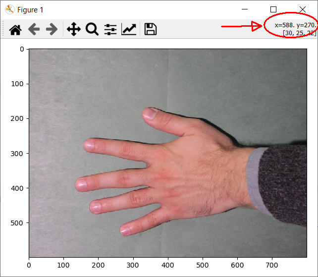
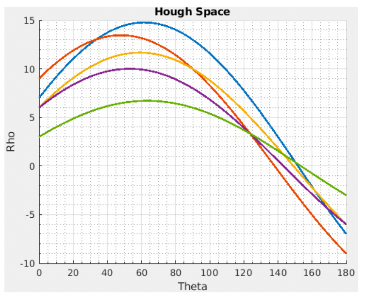
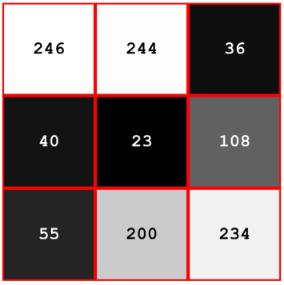

***Solution is now available! Download the full solution from here:*** [Solution](../downloads/sol_material-7.zip){ .md-button .md-button--primary .inline-button }

## Image rotation

One of the most useful and simple geometric transformation is rotation, where an image is rotated around a point. 

We start by some experiments on the image called **NusaPenida.png**. It can be found in the [exercise material](https://github.com/RasmusRPaulsen/DTUImageAnalysis/tree/main/exercises/Ex7-GeometricTransformationsAndRegistration/data).

### Exercise 1

Read the **NusaPenida.png** image and call it **im_org**. It can be rotated by:

``` python
# angle in degrees - counter clockwise
rotation_angle = 10
rotated_img = rotate(im_org, rotation_angle)
show_comparison(im_org, rotated_img, "Rotated image")
```

Notice, that in this function, the angle should be given in degrees.

By default, the image is rotated around the center of the image. This can be changed by manually specifying the point that the image should be rotated around (here (0, 0)):

``` python
rot_center = [0, 0]
rotated_img = rotate(im_org, rotation_angle, center=rot_center)
```

<!-- START_SOLUTION 1 -->
??? tip "Solution 1"
    ```py

    im_org = io.imread('data/NusaPenida.png')

    rotation_angle = 10
    rotated_img = rotate(im_org, rotation_angle)
    show_comparison(im_org, rotated_img, "Rotated image")
    ```
    ```py
    rot_center = [0, 0]
    rotated_img = rotate(im_org, rotation_angle, center=rot_center)
    show_comparison(im_org, rotated_img, "Rotated image")
    ```
<!-- END_SOLUTION 1 -->

### Exercise 2

Experiment with different center points and notice the results.

As seen, there are areas of the rotated image that is filled with a background value. It can be controlled how this background filling shall behave.

Here the background filling mode is set to **reflect**

``` python
rotated_img = rotate(im_org, rotation_angle, mode="reflect")
```

<!-- START_SOLUTION 2 -->
??? tip "Solution 2"
    ```py

    rotated_img = rotate(im_org, rotation_angle, mode="reflect")
    show_comparison(im_org, rotated_img, "Rotated image")
    ```
<!-- END_SOLUTION 2 -->

### Exercise 3

Try the rotation with background filling mode **reflect** and **wrap** and notice the results and differences.

??? INFO
    It is also possible to define a constant fill value. Currently, sci-kit image only supports a single value (not RGB). 

<!-- START_SOLUTION 3 -->
??? tip "Solution 3"
    ```py

    rotated_img = rotate(im_org, rotation_angle, mode="wrap")
    show_comparison(im_org, rotated_img, "Rotated image")
    ```
<!-- END_SOLUTION 3 -->

### Exercise 4
Try to use:

``` python
rotated_img = rotate(im_org, rotation_angle, resize=True, mode="constant", cval=1)
```

with different values of `cval` and notice the outcomes.

By default, the rotated output image has the same size as the input image and therefore some parts of the rotated image are cropped away. It is possible to automatically adjust the output size, so the rotated image fits into the resized image.

<!-- START_SOLUTION 4 -->
??? tip "Solution 4"
    ```py

    rotated_img = rotate(im_org, rotation_angle, resize=True, mode="constant", cval=1)
    show_comparison(im_org, rotated_img, "Rotated image")
    ```
<!-- END_SOLUTION 4 -->

### Exercise 5

Test the use of automatic resizing:

``` python
rotated_img = rotate(im_org, rotation_angle, resize=True)
```

also combine resizing with different background filling modes.

<!-- START_SOLUTION 5 -->
??? tip "Solution 5"
    ```py

    rotated_img = rotate(im_org, rotation_angle, resize=True)
    show_comparison(im_org, rotated_img, "Rotated image")
    ```
<!-- END_SOLUTION 5 -->

## Euclidean image transformation

An alternative way of doing geometric image transformations is to first construct the transformation and then apply it to the image. We will start by the **Euclidean** image transformation that consists of a rotation and a translation. It is also called a *rigid body transformation*.

### Exercise 6

Start by defining the transformation:

``` python
# angle in radians - counter clockwise
rotation_angle = 10.0 * math.pi / 180.
trans = [10, 20]
tform = EuclideanTransform(rotation=rotation_angle, translation=trans)
print(tform.params)
```

it can be seen in the print statement that the transformation consists of a *3 x 3 matrix*. The matrix is used to transform points using **homogenous coordinates**. Notice that the angle is defined in radians in this function.

<!-- START_SOLUTION 6 -->
??? tip "Solution 6"
    ```py

    # angle in radians - counter clockwise
    rotation_angle = 10.0 * math.pi / 180.
    trans = [10, 20]
    tform = EuclideanTransform(rotation=rotation_angle, translation=trans)
    print(tform.params)
    ```
<!-- END_SOLUTION 6 -->

### Exercise 7

The computed transform can be applied to an image using the `warp` function:
``` python
transformed_img = warp(im_org, tform)
```

Try it.


??? INFO
    The `warp` function actually does an *inverse* transformation of the image, since it uses the transform to find the pixels values in the input image that should be placed in the output image.

<!-- START_SOLUTION 7 -->
??? tip "Solution 7"
    ```py

    transformed_img = warp(im_org, tform)
    show_comparison(im_org, transformed_img, "Rigid transformation image")
    ```
<!-- END_SOLUTION 7 -->

## Inverse transformation

It is possible to get the inverse of a computed transform by using `tform.inverse`. An image can then be transformed using the inverse transform by:

``` python
transformed_img = warp(im_org, tform.inverse)
```

### Exercise 8

Construct a Euclidean transformation with only rotation. Test the transformation and the invers transformation and notice the effect.

<!-- START_SOLUTION 8 -->
??? tip "Solution 8"
    ```py

    rotation_angle = 10.0 * math.pi / 180.
    trans = [0, 0]
    tform = EuclideanTransform(rotation=rotation_angle, translation=trans)
    transformed_img = warp(im_org, tform.inverse)

    show_comparison(im_org, transformed_img, "Inverted rigid transformation")
    ```
<!-- END_SOLUTION 8 -->

## Similarity transform of image

The `SimilarityTransform` computes a transformation consisting of a translation, rotation and a scaling. 

### Exercise 9

Define a `SimilarityTransform` with an angle of $15^o$, a translation of (40, 30) and a scaling of 0.6 and test it on the image.

<!-- START_SOLUTION 9 -->
??? tip "Solution 9"
    ```py

    rotation_angle = 15.0 * math.pi / 180.
    trans = [40, 30]
    scale = 0.6
    tform = SimilarityTransform(scale = scale, rotation = rotation_angle, translation = trans)

    recovered_img = warp(transformed_img, tform)
    show_comparison(im_org, recovered_img, "Similarity transformation")
    ```
<!-- END_SOLUTION 9 -->

## The swirl image transformation

The **swirl** image transform is a non-linear transform that can create interesting visual results on images.

### Exercise 10

Try the swirl transformation:

``` python
str = 10
rad = 300
swirl_img = swirl(im_org, strength=str, radius=rad)
```

it is also possible to change the center of the swirl:

``` python
str = 10
rad = 300
c = [500, 400]
swirl_img = swirl(im_org, strength=str, radius=rad, center=c)
```

try with different centers and notice the results.

<!-- START_SOLUTION 10 -->
??? tip "Solution 10"
    ```py

    strength = 10
    rad = 300
    swirl_img = swirl(im_org, strength=strength, radius=rad)

    show_comparison(im_org, swirl_img, 'Swirl transformation')
    ```
    ```py
    strength = 10
    rad = 300
    c = [500, 400]
    swirl_img = swirl(im_org, strength=strength, radius=rad, center=c)
    show_comparison(im_org, swirl_img, 'Swirl transformation')
    ```
<!-- END_SOLUTION 10 -->

# Landmark based registration

The goal of landmark based registration is to align two images using a set of landmarks placed in both images. The landmarks need to have *correspondence* meaning that the landmarks should be placed on the same anatomical spot in the two images.

There are two photos of hands: **Hand1.jpg** and **Hand2.jpg** and the goal is to transform **Hand1** so it fits on top of **Hand2**. In this exercise we call Hand1 one for the *source* (src) and Hand2 for the *destination* (dst).

### Exercise 11

Start by reading the two images into *src_img* and *dst_img*. Visualize their overlap by:

``` python
blend = 0.5 * img_as_float(src_img) + 0.5 * img_as_float(dst_img)
io.imshow(blend)
io.show()
```

<!-- START_SOLUTION 11 -->
??? tip "Solution 11"
    ```py

    src_img = io.imread('data/Hand1.jpg')
    dst_img = io.imread('data/Hand2.jpg')
    ```

    ```py
    plt.imshow(src_img)
    ```

    ```py
    plt.imshow(dst_img)
    ```
    ```py
    blend = 0.5 * img_as_float(src_img) + 0.5 * img_as_float(dst_img)
    io.imshow(blend)
    io.show()
    ```
<!-- END_SOLUTION 11 -->

## Manual landmark annotation

We will manually placed landmarks on the two images to align the them.

### Exercise 12
We have manually placed a set of landmarks on the source image. They can be visualized by:

``` python
src = np.array([[588, 274], [328, 179], [134, 398], [260, 525], [613, 448]])

plt.imshow(src_img)
plt.plot(src[:, 0], src[:, 1], '.r', markersize=12)
plt.show()
```

<!-- START_SOLUTION 12 -->
??? tip "Solution 12"
    ```py

    src = np.array([[588, 274], [328, 179], [134, 398], [260, 525], [613, 448]])

    plt.imshow(src_img)
    plt.plot(src[:, 0], src[:, 1], '.r', markersize=12)
    plt.show()
    ```
<!-- END_SOLUTION 12 -->

### Exercise 13

You should now place the same landmarks on the destination image. 

In `imshow` you can see the pixel coordinates of the cursor:



Use this to find the coordinates of the sought landmarks and put them into a `dst` variable.

Plot the landmarks to verify they are correct:

``` python
fig, ax = plt.subplots()
ax.plot(src[:, 0], src[:, 1], '-r', markersize=12, label="Source")
ax.plot(dst[:, 0], dst[:, 1], '-g', markersize=12, label="Destination")
ax.invert_yaxis()
ax.legend()
ax.set_title("Landmarks before alignment")
plt.show()
```

To calculate how well two sets of landmarks are aligned, we can compute the *objective function*:

$$ F = \sum_{i=1}^N \|a_i - b_i\|^2 \enspace ,$$

here $a_i$ are the landmarks in the destination image and $b_i$ are the landmarks in the source image.

<!-- START_SOLUTION 13 -->
??? tip "Solution 13"
    ```py

    # Change the backend to be able to explore the pixel intensities
    # For VSCode Notebooks and JupyterNotebook "%matplotlib widget"
    # For Spyder "%matplotlib auto"

    %matplotlib widget 
    plt.imshow(src_img)
    plt.show()
    ```
    ```py
    %matplotlib inline

    plt.close()

    dst = np.array([[621, 293], [382, 166], [198, 266], [270, 440], [600, 450]])

    fig, ax = plt.subplots()
    ax.plot(src[:, 0], src[:, 1], '-r', markersize=12, label="Source")
    ax.plot(dst[:, 0], dst[:, 1], '-g', markersize=12, label="Destination")
    ax.invert_yaxis()
    ax.legend()
    ax.set_title("Landmarks before alignment")
    plt.show()
    ```
<!-- END_SOLUTION 13 -->

### Exercise 14

Compute $F$ from your landmarks. It can for example be done like:

``` python
e_x = src[:, 0] - dst[:, 0]
error_x = np.dot(e_x, e_x)
e_y = src[:, 1] - dst[:, 1]
error_y = np.dot(e_y, e_y)
f = error_x + error_y
print(f"Landmark alignment error F: {f}")
```

The optimal Euclidean transformation that brings the source landmarks over in the destination landmarks can be found by:

``` python
tform = EuclideanTransform()
tform.estimate(src, dst)
```

The found transform can be applied to the source points by:

``` python
src_transform = matrix_transform(src, tform.params)
```

<!-- START_SOLUTION 14 -->
??? tip "Solution 14"
    ```py

    e_x = src[:, 0] - dst[:, 0]
    error_x = np.dot(e_x, e_x)
    e_y = src[:, 1] - dst[:, 1]
    error_y = np.dot(e_y, e_y)
    f = error_x + error_y
    print(f"Landmark alignment error F: {f}")

    #Can also be calculated in a more compact manner like this:
    # f = np.sum((src - dst)**2)
    ```
    ```py
    tform = EuclideanTransform()
    tform.estimate(src, dst)

    src_transform = matrix_transform(src, tform.params)
    ```
<!-- END_SOLUTION 14 -->

### Exercise 15

Visualize the transformed source landmarks together with the destination landmarks. Also compute the objective function $F$ using the transformed points. What do you observe?

<!-- START_SOLUTION 15 -->
??? tip "Solution 15"
    ```py

    fig, ax = plt.subplots()
    io.imshow(dst_img)
    ax.plot(src_transform[:, 0], src_transform[:, 1], '-r', markersize=12, label="Source transform")
    ax.plot(dst[:, 0], dst[:, 1], '-g', markersize=12, label="Destination")
    ax.invert_yaxis()
    ax.legend()
    ax.set_title("Landmarks before alignment")
    plt.show()
    ```

    ```py
    e_x = src_transform[:, 0] - dst[:, 0]
    error_x = np.dot(e_x, e_x)
    e_y = src_transform[:, 1] - dst[:, 1]
    error_y = np.dot(e_y, e_y)
    f = error_x + error_y
    print(f"Landmark alignment error F: {f}")
    ```
    The error has decreased, as expected.
<!-- END_SOLUTION 15 -->

### Exercise 16

We can now apply the transformation to the source image. Notice that we use the inverse transform due to the inverse mapping in the image resampling:

``` python
warped = warp(src_img, tform.inverse)
```

Show the warped image and also try to blend the warped image destination image like in exercise 11. What do you observe?

<!-- START_SOLUTION 16 -->
??? tip "Solution 16"
    ```py

    warped = warp(src_img, tform.inverse)
    show_comparison(src_img, warped, 'Landmark based transformation')
    ```
    ```py
    blend = 0.5 * img_as_float(src_img) + 0.5 * img_as_float(warped)
    io.imshow(blend)
    io.show()
    ```
<!-- END_SOLUTION 16 -->

## Video transformations

Now try to make a small program, that acquires video from your webcam/telephone, transforms it and shows the output. In [Imports and Functions](../imports_and_functions/#exercise-script-for-transformation-on-video)
 there is a program that can be modified. 

By default, the program acquires a colour image and rotates it. There is a counter that is increased every frame and that counter can be used to modify the transformation (for example the rotation angle). The program also measures how many milliseconds the image processing takes. 

### Exercise 17

Run the example program and notice how the output image rotates.

<!-- START_SOLUTION 17 -->
??? tip "Solution 17"
    Run from jupyter by executing solution file: 

    ```py
    !python Ex7-VideoImageTransformations_solution.py
    ```

    in a code block.
    The solution file contains:

    ```py
    import time
    import cv2
    from skimage.transform import swirl
    from skimage.transform import rotate
    import math


    def show_in_moved_window(win_name, img, x, y):
        """
        Show an image in a window, where the position of the window can be given
        """
        cv2.namedWindow(win_name)
        cv2.moveWindow(win_name, x, y)
        cv2.imshow(win_name, img)


    def process_rgb_image(img, counter):
        """
        Simple processing of a color (RGB) image
        """
        str = math.sin(counter / 10) * 10
        rad = 300
        swirl_img = swirl(img, strength=str, radius=rad)
        return swirl_img


    def capture_from_camera_and_show_images():
        print("Starting image capture")

        print("Opening connection to camera")
        url = 0
        use_droid_cam = False
        if use_droid_cam:
            url = "http://192.168.1.120:4747/video"
        cap = cv2.VideoCapture(url)
        if not cap.isOpened():
            print("Cannot open camera")
            exit()

        print("Starting camera loop")
        # To keep track of frames per second using a high-performance counter
        old_time = time.perf_counter()
        fps = 0
        stop = False
        counter = 0
        while not stop:
            ret, new_frame = cap.read()
            if not ret:
                print("Can't receive frame. Exiting ...")
                break

            # Change from OpenCV BGR to scikit image RGB
            new_image = new_frame[:, :, ::-1]
            proc_time_start = time.perf_counter()
            proc_img = process_rgb_image(new_image, counter)
            proc_time = time.perf_counter() - proc_time_start
            # convert back to OpenCV BGR to show it
            proc_img = proc_img[:, :, ::-1]

            counter = counter + 1

            # update FPS - but do it slowly to avoid fast changing number
            new_time = time.perf_counter()
            time_dif = new_time - old_time
            old_time = new_time
            fps = fps * 0.95 + 0.05 * 1 / time_dif

            # Put the FPS on the new_frame
            str_out = f"fps: {int(fps)} proc.time: {int(proc_time * 1000)} ms"
            font = cv2.FONT_HERSHEY_COMPLEX
            cv2.putText(new_frame, str_out, (100, 100), font, 1, 255, 1)

            # Display the resulting frame
            show_in_moved_window('Input', new_frame, 0, 10)
            show_in_moved_window('Processed image', proc_img, 700, 10) #1200, 10

            if cv2.waitKey(1) == ord('q'):
                stop = True

        print("Stopping image loop")
        cap.release()
        cv2.destroyAllWindows()


    if __name__ == '__main__':
        capture_from_camera_and_show_images()
    ```
<!-- END_SOLUTION 17 -->

### Exercise 18

Modify the program so it performs the **swirl** transform on the image. The parameters of the swirl transform can be changed using the counter. For example:

``` python
str = math.sin(counter / 10) * 10
```

Try this and also try to change the other transform parameters using the counter.

<!-- START_SOLUTION 18 -->
??? tip "Solution 18"
    Run from jupyter by executing solution file: 

    ```py
    !python Ex7-VideoImageTransformations_solution.py
    ```

    in a code block.
    The solution file contains:

    ```py
    import time
    import cv2
    from skimage.transform import swirl
    from skimage.transform import rotate
    import math


    def show_in_moved_window(win_name, img, x, y):
        """
        Show an image in a window, where the position of the window can be given
        """
        cv2.namedWindow(win_name)
        cv2.moveWindow(win_name, x, y)
        cv2.imshow(win_name, img)


    def process_rgb_image(img, counter):
        """
        Simple processing of a color (RGB) image
        """
        str = math.sin(counter / 10) * 10
        rad = 300
        swirl_img = swirl(img, strength=str, radius=rad)
        return swirl_img


    def capture_from_camera_and_show_images():
        print("Starting image capture")

        print("Opening connection to camera")
        url = 0
        use_droid_cam = False
        if use_droid_cam:
            url = "http://192.168.1.120:4747/video"
        cap = cv2.VideoCapture(url)
        if not cap.isOpened():
            print("Cannot open camera")
            exit()

        print("Starting camera loop")
        # To keep track of frames per second using a high-performance counter
        old_time = time.perf_counter()
        fps = 0
        stop = False
        counter = 0
        while not stop:
            ret, new_frame = cap.read()
            if not ret:
                print("Can't receive frame. Exiting ...")
                break

            # Change from OpenCV BGR to scikit image RGB
            new_image = new_frame[:, :, ::-1]
            proc_time_start = time.perf_counter()
            proc_img = process_rgb_image(new_image, counter)
            proc_time = time.perf_counter() - proc_time_start
            # convert back to OpenCV BGR to show it
            proc_img = proc_img[:, :, ::-1]

            counter = counter + 1

            # update FPS - but do it slowly to avoid fast changing number
            new_time = time.perf_counter()
            time_dif = new_time - old_time
            old_time = new_time
            fps = fps * 0.95 + 0.05 * 1 / time_dif

            # Put the FPS on the new_frame
            str_out = f"fps: {int(fps)} proc.time: {int(proc_time * 1000)} ms"
            font = cv2.FONT_HERSHEY_COMPLEX
            cv2.putText(new_frame, str_out, (100, 100), font, 1, 255, 1)

            # Display the resulting frame
            show_in_moved_window('Input', new_frame, 0, 10)
            show_in_moved_window('Processed image', proc_img, 700, 10) #1200, 10

            if cv2.waitKey(1) == ord('q'):
                stop = True

        print("Stopping image loop")
        cap.release()
        cv2.destroyAllWindows()


    if __name__ == '__main__':
        capture_from_camera_and_show_images()
    ```
<!-- END_SOLUTION 18 -->


## Exam preparation 
Below are some example exam exercises related to this weeks material. Work with them, and if you have issues or questions, please ask the TAs, as you will not be able to get help after the last exercise round.


To be able to do a landmark-based image registration between a reference image and a template image, two sets of corresponding landmarks have been placed in the two images. The landmarks can be seen in the table:

| Landmarks in reference | x | y | Landmarks in template | x | y |
| ---------------------- | -- | -- | --------------------- | -- | -- |
| a1                     | 3  | 3  | b1                    | 6  | 7  |
| a2                     | 4  | 2  | b2                    | 3  | 7  |
| a3                     | 7  | 3  | b3                    | 2  | 2  |

Before the registration, the first point in the reference image is rotated with 11 degrees using a rotation matrix (rotating counter-clockwise). 

*Exam question 1: What is the squared distance objective function $F$ between the two point-sets?* 

- [ ] 41.2
- [ ] 53.4
- [ ] 77.3
- [ ] 101.2
- [ ] 23.2
- [ ] Do not know

<!-- START_SOLUTION 19 -->
??? tip "Solution 19"
    - [ ] 41.2
    - [ ] 53.4
    - [x] 77.3
    - [ ] 101.2
    - [ ] 23.2
    - [ ] Do not know
<!-- END_SOLUTION 19 -->

*Exam question 2: The points in the reference image are translated using a translation vector of $t=(-2, 5)$. What is the change in the squared distance objective function $F$ between the two point-sets?*

- [ ] 89
- [ ] 46
- [ ] 77
- [ ] 123
- [ ] 99
- [ ] Do not know

<!-- START_SOLUTION 20 -->
??? tip "Solution 20"
    - [x] 89
    - [ ] 46
    - [ ] 77
    - [ ] 123
    - [ ] 99
    - [ ] Do not know
<!-- END_SOLUTION 20 -->


*Exam question 3: A company producing farming machines wants you to develop an automated system for plant identification. The specific plant typically has red leaves and is often found on brown farmland surrounded by green crops. What could be the pipeline that you would use to solve the task?*

- [ ] Image acquisition, HSI color thresholding, morphological operations, BLOB analysis, feature classification
- [ ] Image acquisition, landmark registration, chain coding
- [ ] Binary run-length coding, PCA analysis, histogram stretching, morphological closing
- [ ] Hough transformation, parametric classification, confusion matrix, grey-level run length coding
- [ ] Gaussian filtering, active shape model, binary chain coding, automatic thresholding
- [ ] Do not know

<!-- START_SOLUTION 21 -->
??? tip "Solution 21"
    - [x] Image acquisition, HSI color thresholding, morphological operations, BLOB analysis, feature classification
    - [ ] Image acquisition, landmark registration, chain coding
    - [ ] Binary run-length coding, PCA analysis, histogram stretching, morphological closing
    - [ ] Hough transformation, parametric classification, confusion matrix, grey-level run length coding
    - [ ] Gaussian filtering, active shape model, binary chain coding, automatic thresholding
    - [ ] Do not know
<!-- END_SOLUTION 21 -->

---
For the following exercise, all data is provided in ***data/exam_prep/***.
Two photos with toy figures have been taken with a standard camera (play1.png and play5.png).Five landmarks have been placed on the photos and stored in the files playfixedPoints.mat and playmovingPoints.mat.

A similarity transform (translation, rotation, and scaling) has been computed so that it aligns the moving points to the fixed points. The computed transform is applied to the play5.png photo. After the transformation, a threshold is applied to the transformed image, so pixels below 180 are assigned to foreground (1) and the pixels above 180 are background (0).

A reference image called reference.png is provided. The DICE score between the reference image and the transformed (and thresholded) image is computed. 

*Exam question 4: What is this DICE score?*

- [ ] Between 0.85 and 0.90
- [ ] Between 0.75 and 0.80
- [ ] Do not know
- [ ] Between 0.70 and 0.75.
- [ ] Between 0.80 and 0.85
- [ ] Between 0.90 and 0.95

<!-- START_SOLUTION 22 -->
??? tip "Solution 22"
    - [ ] Between 0.85 and 0.90
    - [ ] Between 0.75 and 0.80
    - [ ] Do not know
    - [ ] Between 0.70 and 0.75.
    - [x] Between 0.80 and 0.85
    - [ ] Between 0.90 and 0.95
<!-- END_SOLUTION 22 -->

*Exam question 5: What is the Euclidean distance between the first landmark in the fixed points and the first landmark in the moving points?*

- [ ] 86.1
- [ ] 97.1
- [ ] 165.7
- [ ] 181.2
- [ ] 132.4
- [ ] Do not know

<!-- START_SOLUTION 23 -->
??? tip "Solution 23"
    - [ ] 86.1
    - [ ] 97.1
    - [x] 165.7
    - [ ] 181.2
    - [ ] 132.4
    - [ ] Do not know
<!-- END_SOLUTION 23 -->

--- 
#### Exam exercise on Hough transform 

The five data points (x, y): (7,13), (9,10), (6,10), (6,8), (3,6) 

result in the corresponding five Hough space sinograms (curves in Hough space) shown below. Two Hough space sinograms are crossing at ($\rho$ = 0.29, $\theta$ = $151^\circ$).



*Exam question 6: What are the corresponding data points for the two crossing curves in Hough space? (approximately)*

- [ ] (9, 10) and (6, 10)
- [ ] (7, 13) and (3, 6)
- [ ] (9, 10) and (7, 13)
- [ ] (6, 10) and (3, 6)
- [ ] Do not know
- [ ] (7, 13) and (6, 10)

<!-- START_SOLUTION 24 -->
??? tip "Solution 24"
    - [ ] (9, 10) and (6, 10)
    - [x] (7, 13) and (3, 6)
    - [ ] (9, 10) and (7, 13)
    - [ ] (6, 10) and (3, 6)
    - [ ] Do not know
    - [ ] (7, 13) and (6, 10)
<!-- END_SOLUTION 24 -->


--- 
#### Exam exercise on dynamic programming, fall 2018 
A gamma mapping with $\gamma = 1.12$ is performed on the image in the below figure. 



All pixels are then rounded to integers. Dynamic programming is used to compute the optimal path from the top to the bottom of the resulting image. 

*Exam question 7: What are the values in the lowest row in the accumulator image?*


- [ ] 103, 215, 234
- [ ] 101, 233, 250
- [ ] 40, 122, 130
- [ ] 50, 200, 121
- [ ] 91, 239, 277
- [ ] Do not know

<!-- START_SOLUTION 25 -->
??? tip "Solution 25"
    - [ ] 103, 215, 234
    - [ ] 101, 233, 250
    - [ ] 40, 122, 130
    - [x] 50, 200, 121
    - [ ] 91, 239, 277
    - [ ] Do not know
<!-- END_SOLUTION 25 -->


## References
- [sci-kit image transformations](https://scikit-image.org/docs/stable/api/skimage.transform.html)
- [sci-kit image rotation](https://scikit-image.org/docs/stable/api/skimage.transform.html#skimage.transform.rotate)
- [transformation example](https://scikit-image.org/docs/stable/auto_examples/transform/plot_geometric.html#sphx-glr-auto-examples-transform-plot-geometric-py)
- [swirl transform](https://scikit-image.org/docs/stable/auto_examples/transform/plot_swirl.html#sphx-glr-auto-examples-transform-plot-swirl-py
)

